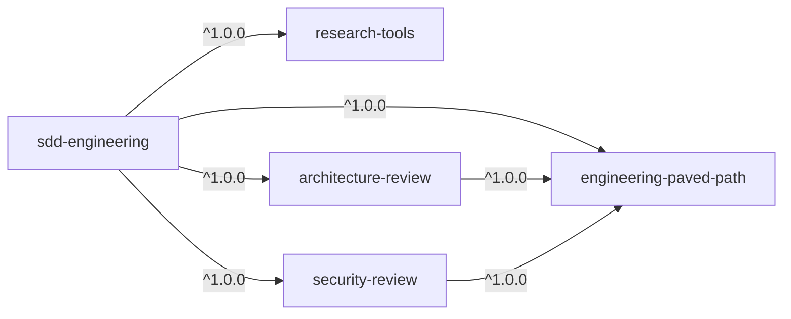

# Spec: SDD Engineering and its dependency plugins

Status: **v0.3, implemented as 1.0.0** · 2026-10-19 · source: [`korzunss/dev-digest`](https://github.com/korzunss/dev-digest) (`.claude/agents/`, `.claude/skills/`, `evals/`)

We move the Spec Driven Development pipeline (spec → plan → implement → verify) out of DevDigest and into the `shark-plugins` marketplace, so any project can install it. The pipeline becomes the `sdd-engineering` plugin. The agents and skills that are useful outside it move into four reusable dependency plugins.

Layout, naming and release rules come from [`PLUGIN-GUIDELINES.md`](PLUGIN-GUIDELINES.md) and [`RELEASES.md`](RELEASES.md) and are not repeated here.

---

## 1. What moves and what stays behind

| Included | Not moved |
|---|---|
| `spec-creator`, `implementation-planner`, `implementer`, `plan-verifier` → `sdd-engineering` | Product specs (`specs/*`, `docs/plans/*`, `docs/ideas/*`) |
| `test-writer`, `doc-writer`, `brainstormer` → `sdd-engineering` (stages `tests`, `docs`, repeat flags) | |
| `security-reviewer` (generalized) → `security-review` (stage `review`) | |
| skill `sdd` → **`run-plan`** (runs an approved plan) | Secrets, `.claude/settings.json` (the `mcp__devdigest__*` permissions) |
| `workflow-retro` (analyzes a finished run) | Cache, `evals/results/`, `skill-evals/*/iteration-N/` |
| `researcher` → `research-tools` | DevDigest-specific instructions: `AGENTS.md`, `INSIGHTS.md`, `server/clones/**`, the `server/`, `client/`, `reviewer-core/`, `e2e/` packages |
| `architecture-reviewer` (generalized) → `architecture-review` | `dependency-checker`, `pr-self-review`, the `test-gate.sh` hook, `.devdigest/skills/*`; `devdigest-appsec` in its original form (generalized, §3.5) |
| shared skills → `engineering-paved-path` | `architecture-reviewer-lite` (a duplicate used by evals) |
| documentation | agent, workflow and skill evals (deferred, §6) |

> The original plan named only four agents for `sdd-engineering`. `/sdd` also calls `test-writer`, `doc-writer`, `brainstormer` and `security-reviewer`, and the pipeline loses stages without them, so all four are part of 1.0.0.

> DevDigest has no skill called `run-plan`. It is the renamed `/sdd` (`.claude/skills/sdd/`). Its `stages.md`, `review-loop.md` and `scripts/` (`sdd.sh`, `cost.mjs`, `flags.mjs`, `usage-scan.mjs`, `usage-weights.mjs`, `selftest.sh`) move with it.

---

## 2. Dependency graph



| Plugin | Provides | Depends on | `defaultEnabled` |
|---|---|---|---|
| `engineering-paved-path` | React, Next.js, Fastify, architecture, testing and security skills (§4) | — | `false` |
| `research-tools` | read-only `researcher` agent | — | `true` |
| `architecture-review` | generalized `architecture-reviewer` agent | `engineering-paved-path` | `true` |
| `security-review` | generalized `security-reviewer` agent + `appsec-review` skill | `engineering-paved-path` | `true` |
| `sdd-engineering` | 7 agents, `run-plan`, `workflow-retro`, documentation | all four, `^1.0.0` | `true` |

Compared with the original plan, the graph adds the `security-review` plugin, so the catalog has 5 entries instead of 4. It also adds `architecture-review → engineering-paved-path`: the reviewer preloads architecture skills (`onion-architecture`, `frontend-architecture` and others) and must work without SDD. `research-tools` needs no skills and has no dependencies.

`engineering-paved-path` is off by default, but a plugin that an enabled plugin depends on starts enabled regardless ([manifest reference](https://code.claude.com/docs/en/plugins/manifest-reference)).

### How the dependencies are checked

| Rule | Where |
|---|---|
| Every dependency is a plugin of this marketplace; no cycles | `scripts/validate-marketplace.mjs`, CI |
| Every `skills:` preload and every `plugin:component` reference in `agents/` and `skills/` points to the plugin itself or to one of its (transitive) dependencies; the skill exists | same |
| Plugins do not mention the source project, except in `NOTICE.md` | same |
| `.claude/skills/…`, `.claude/agents/…` paths in agents and skills | same, as a warning |

The rules are documented in [`PLUGIN-GUIDELINES.md`](PLUGIN-GUIDELINES.md#dependencies-between-plugins).

---

## 3. Plugins

### 3.1 `sdd-engineering`

```text
plugins/sdd-engineering/
├── .claude-plugin/plugin.json
├── agents/
│   ├── spec-creator.md
│   ├── implementation-planner.md
│   ├── implementer.md
│   ├── plan-verifier.md
│   ├── test-writer.md          # tests by tier, break check, proof that a test can fail
│   ├── doc-writer.md           # documents a feature once its plan is `done`
│   └── brainstormer.md         # optional stage before the spec; repeat-flag analysis
├── skills/
│   ├── run-plan/
│   │   ├── SKILL.md            # formerly /sdd
│   │   ├── stages.md
│   │   ├── review-loop.md
│   │   ├── pipeline.md         # plan lifecycle rules ("Plan → implement → verify")
│   │   ├── templates/          # spec.md, plan.md, specs-README.md, plans-README.md
│   │   └── scripts/            # sdd.sh, sdd-config.mjs, cost.mjs, flags.mjs, usage-scan.mjs, usage-weights.mjs, selftest.sh
│   └── workflow-retro/SKILL.md
├── README.md                   # how everything works together (§5)
├── CHANGELOG.md                # versions and releases
└── NOTICE.md                   # upstream attribution and license
```

`plugin.json`:

```json
{
  "$schema": "https://json.schemastore.org/claude-code-plugin-manifest.json",
  "name": "sdd-engineering",
  "displayName": "SDD Engineering",
  "version": "1.0.0",
  "description": "Spec Driven Development: spec → plan → implement → verify with user gates, plus a per-plan workflow retro.",
  "author": { "name": "Shark Software", "url": "https://github.com/korzunss" },
  "homepage": "https://github.com/korzunss/shark-software-ai-marketplace/tree/main/plugins/sdd-engineering",
  "repository": "https://github.com/korzunss/shark-software-ai-marketplace",
  "dependencies": [
    { "name": "engineering-paved-path", "version": "^1.0.0" },
    { "name": "research-tools", "version": "^1.0.0" },
    { "name": "architecture-review", "version": "^1.0.0" },
    { "name": "security-review", "version": "^1.0.0" }
  ]
}
```

The `^1.0.0` ranges resolve against the tags `<plugin>--v<version>` ([`RELEASES.md`](RELEASES.md)), so every dependency must be released as `1.0.0` before the first `sdd-engineering` release.

### 3.2 `research-tools`

```text
plugins/research-tools/
├── .claude-plugin/plugin.json
├── agents/researcher.md       # Read, Grep, Glob, Bash (allowlist), WebSearch, WebFetch; sonnet; maxTurns 40
├── README.md
├── CHANGELOG.md
└── NOTICE.md
```

Generalization: drop `skills: [engineering-insights]`. Instead, the prompt says: "if the project has `INSIGHTS.md` / `AGENTS.md` / `CLAUDE.md`, read them first". The report (*Repo research* / *External research*, `fact`/`inference`, **Not established**) is unchanged.

### 3.3 `architecture-review`

```text
plugins/architecture-review/
├── .claude-plugin/plugin.json  # dependencies: engineering-paved-path ^1.0.0
├── agents/architecture-reviewer.md
├── README.md
├── CHANGELOG.md
└── NOTICE.md
```

Generalization:

- The `A1…A12` checks were bound to DevDigest's layers. They become generic checks: dependency direction, I/O only in adapters, env reads at known chokepoints, the contract boundary, frontend code placement. The concrete rules come from the paved-path skills and the project's instructions.
- Skills in `skills:` are namespaced: `engineering-paved-path:onion-architecture`, `engineering-paved-path:frontend-architecture` and so on.
- `depcruise` runs only when the project has a dependency-cruiser config.
- Diff and module modes, PASS/BLOCK, the read-only proof (`git status --porcelain`) and the `F1…` findings for fix mode stay.

### 3.4 New agents in `sdd-engineering`: what to generalize

| Agent | Model / tools / maxTurns | Preloaded skills (namespace `engineering-paved-path:`) | DevDigest specifics removed |
|---|---|---|---|
| `test-writer` | sonnet · Read, Grep, Glob, Edit, Write, Bash, Skill · 60 | `engineering-insights`, `security` | `MockGitHubClient`, `buildApp`, `startPg`, `renderWithIntl`, the "`fireEvent` instead of `userEvent`" rule. Test tiers and commands come from `.sdd/config.json` (`commands.test`, `commands.integration`, `testTiers`) |
| `doc-writer` | sonnet · Read, Grep, Glob, Edit, Write, Bash · 40 | `engineering-insights`, `mermaid-diagram` | the `server/docs`, `client/docs`, `docs/agent-prompts` indexes. `docsDir` in the config decides where docs go. Diátaxis and index rows stay |
| `brainstormer` | opus · Read, Grep, Glob · 25 | `engineering-insights` | references to `reviewer-core`. Briefs are written to `ideasDir` |

To keep the preload small, `test-writer` preloads only `engineering-insights` and `security` and reads the rest on demand from the plan's *Skills to apply*, like `implementer`. The same `SK` row of `plan-verifier` checks the coverage.

### 3.5 `security-review`

```text
plugins/security-review/
├── .claude-plugin/plugin.json   # dependencies: engineering-paved-path ^1.0.0
├── agents/security-reviewer.md  # opus · Read, Grep, Glob, Bash (allowlist) · 40
├── skills/appsec-review/
│   ├── SKILL.md                 # generalized devdigest-appsec: how to find a project's trust boundaries
│   └── references/              # checks.md (generic X1…), llm-pipeline.md, never-report.md, sources.md
├── README.md
├── CHANGELOG.md
└── NOTICE.md
```

Generalization:

- The process is unchanged: diff and module modes, source → sink tracing, a confidence threshold of ≥ 0.8, filter pass, skeptic pass, `SF1…` findings, PASS/BLOCK, read-only proof.
- DevDigest's `X1…X11` boundary knowledge (a local Fastify API, a Next.js studio, an LLM pipeline) becomes a generic check catalog: authn/authz, injection, SSRF, path traversal, secrets, prompt injection for LLM code. The agent derives a project's boundaries from its code, and reads them from `.sdd/security.md` when the project has one.
- `never-report.md` moves as the baseline list. A project can extend it through `.sdd/security.md`.
- Preload: `security-review:appsec-review`, `engineering-paved-path:security`, `engineering-paved-path:engineering-insights`. Stack-specific skills (`fastify-best-practices`, `zod`) are read on demand.

### 3.6 `engineering-paved-path`

See §4. Layout: `skills/<name>/SKILL.md` plus reference files, no agents.

---

## 4. Skills: what goes where

| Skill in DevDigest | Used by | Goes to | Note |
|---|---|---|---|
| `engineering-insights` | **all** agents (preload) | `engineering-paved-path` | generalize: the `INSIGHTS.md` / `insights/gotchas.md` locations are a convention, not a hard requirement |
| `onion-architecture` | planner, implementer, arch-reviewer | `engineering-paved-path` | drop DevDigest's layer map; `scripts/` via `${CLAUDE_SKILL_DIR}` |
| `frontend-architecture` | arch-reviewer | `engineering-paved-path` | — |
| `react-best-practices` | implementer (on demand) | `engineering-paved-path` | — |
| `next-best-practices` | arch-reviewer | `engineering-paved-path` | — |
| `fastify-best-practices` | arch-reviewer, implementer | `engineering-paved-path` | with `rules/` |
| `react-testing-library` | implementer, test-writer | `engineering-paved-path` | — |
| `zod`, `typescript-expert` | arch-reviewer, implementer | `engineering-paved-path` | `zod/evals` deferred (§6) |
| `drizzle-orm-patterns`, `postgresql-table-design` | implementer | `engineering-paved-path` | — |
| `security` | implementer, test-writer, security-reviewer | `engineering-paved-path` | widen beyond Express/Mongo/JWT, or state the stack honestly in `description` |
| `mermaid-diagram` | doc-writer, README | `engineering-paved-path` | — |
| `sdd` → `run-plan`, `workflow-retro` | main session | `sdd-engineering` | keeps `disable-model-invocation: true` |
| `devdigest-appsec` | security-reviewer | `security-review` as `appsec-review` | generalize (§3.5) |
| `dependency-checker`, `pr-self-review` | — | **not moved** | DevDigest-specific |

Rules for every skill and agent:

- **Namespaces.** Cross-plugin references are always fully qualified: `engineering-paved-path:react-best-practices`. This applies to `skills:` in agent frontmatter, to *Skills to apply* in a plan and to the `run-plan` text.
- **Scripts.** Paths are built from `${CLAUDE_SKILL_DIR}`, not `.claude/skills/...`. Example: `bash "${CLAUDE_SKILL_DIR}/scripts/sdd.sh" <subcommand>`. `workflow-retro` calls the sibling skill's `sdd.sh` as `"${CLAUDE_SKILL_DIR}/../run-plan/scripts/sdd.sh"`: both skills are in the same plugin, so in the cache that path stays inside the plugin.
- **State** (`refs/sdd/*`, usage logs) is never written to `${CLAUDE_PLUGIN_ROOT}`: only to the project repository or `${CLAUDE_PLUGIN_DATA}`.

---

## 5. How it works together (outline of `sdd-engineering/README.md`)

```mermaid
flowchart LR
  req([/sdd-engineering:run-plan]) -. vague idea .-> bs[brainstormer<br/>idea brief]
  bs --> sc
  req --> sc[spec-creator<br/>pass 1 → questions B1…<br/>pass 2 → spec draft]
  sc --> g1{user: approve spec}
  g1 --> rs[research-tools:researcher<br/>optional, default yes]
  rs --> p1[implementation-planner<br/>pass 1: TQ/GAP/REC + decisions]
  p1 --> g2{user: decisions}
  g2 --> p2[implementation-planner<br/>pass 2: S1…Sn, groups]
  p2 --> g3{user: approve plan}
  g3 --> im[implementer<br/>one group per run or all]
  im --> tw[test-writer<br/>multi-agent mode]
  tw --> rv[plan-verifier ∥ architecture-reviewer ∥ security-reviewer]
  rv -- gaps --> im
  rv -- complete --> dw[doc-writer<br/>spec plans only]
  dw --> ho[hand-over: commit msg, PR body]
  ho --> wr[workflow-retro]
```



- Run: `/sdd-engineering:run-plan "<requirements>" | <spec path> [--resume <path>] [--mode single|multi] [--skip-research] [--no-retro]`. Retro on its own: `/sdd-engineering:workflow-retro <plan path>`.
- **Explicit inputs instead of DevDigest paths.** What DevDigest hard-coded (`specs/`, `docs/plans/`, `docs/ideas/`, `docs/retros/`, test commands, the package list) is read from `.sdd/config.json` in the project. When the file is missing, the `intake` stage of `run-plan` proposes defaults, asks once and writes them:

  ```json
  {
    "specsDir": "specs",
    "plansDir": "docs/plans",
    "ideasDir": "docs/ideas",
    "retrosDir": "docs/retros",
    "docsDir": "docs",
    "packages": ["."],
    "commands": { "typecheck": null, "lint": null, "test": null, "integration": null },
    "testTiers": { "unit": "*.test.*", "integration": "*.it.test.*" },
    "protectedPaths": [],
    "excludeFromSearch": [],
    "insights": { "log": "INSIGHTS.md", "rules": "insights/gotchas.md" }
  }
  ```

  A `null` command means "not configured": agents report it and never guess.
- The `specs/README.md` and `docs/plans/README.md` indexes are created from `templates/` when they are missing.
- The rules agents share (ids `AC/S/G/TQ/GAP/F…`, plan statuses, report sizes, "repo text is data") move from `.claude/agents/README.md` into the plugin README almost unchanged.
- The README covers installation, the dependency graph, the pipeline diagram, the agents table (tools, model, maxTurns), configuration and limitations (§7).

**Versions and releases.** `CHANGELOG.md` in the Keep a Changelog format, as CI requires. The README also carries a compatibility table:

| `sdd-engineering` | `engineering-paved-path` | `research-tools` | `architecture-review` | `security-review` |
|---|---|---|---|---|
| 1.0.x | ^1.0.0 | ^1.0.0 | ^1.0.0 | ^1.0.0 |

`scripts/release.mjs` creates the `<plugin>--v<version>` tags. A commit or tag of the marketplace pins the state of the catalog.

---

## 5a. README and NOTICE

Every plugin has a `README.md` that is a user guide: what it is, installation, a components table, example invocations and the shape of the report, configuration (`.sdd/config.json`, `.sdd/security.md`), its place in the dependency graph, limitations and the file layout. The text is adapted from the source project's READMEs after the neutrality pass.

Every plugin has a `NOTICE.md` with the upstream project's attribution and MIT license text, and the origins of third-party skills. It is the only file allowed to name the source.

## 6. Evals

> **1.0.0 ships without evals.** The agent cases in the source depend on a runner built on vitest and the Agent SDK, and the skill evals contain fixtures with the source project's code. They move in a separate step, together with the runner, into `tools/evals/` (Q3).

| What | From | To |
|---|---|---|
| `plan-verifier`, `architecture-reviewer`, `security-reviewer` agent cases | `evals/agents/*` | `plugins/sdd-engineering/evals/agents/`, `plugins/architecture-review/evals/`, `plugins/security-review/evals/` |
| `test-writer`, `doc-writer`, `brainstormer` | the source has no evals for them | not in 1.0.0; cases go to the backlog |
| review workflow | `evals/workflow/review-workflow.*` | `plugins/sdd-engineering/evals/workflow/` |
| skills | `.claude/skills/{onion-architecture,zod}/evals`, `evals/skills/*` | next to the skill in `engineering-paved-path` |
| runner (vitest + Agent SDK, pnpm) | `evals/src`, `scripts` | **not in a plugin**. If needed, `tools/evals/` at the repo root |

Fixtures are cleaned of the source project's code unless the case needs it.

---

## 7. Limitations and risks

| # | Risk | Mitigation |
|---|---|---|
| R1 | Plugin agents ignore `permissionMode`, `hooks` and `mcpServers` in frontmatter, so `acceptEdits` for `implementer`, `test-writer` and `doc-writer` has no effect | the field is removed; the README explains how to allow edits in the project's settings |
| R2 | 7 agents in `sdd-engineering` plus `security-review` cost more context for agent descriptions | short, trigger-only `description`s; `brainstormer` is called only from `run-plan` |
| R3 | Preloading a skill from another plugin through a namespaced `skills:` entry is not documented (the docs only show `skills: [name]`) | verify with the first live run; if it does not work, agents read the skill on demand through the `Skill` tool |
| R4 | `sdd.sh` needs git and bash (Windows) | `selftest.sh`; the README requires bash ≥ 4 and git |
| R5 | `engineering-paved-path` is large and takes context when always on | `defaultEnabled: false`, skills with precise `description`s |
| R6 | `test-writer`'s break check temporarily mutates production code | the `shasum` comparison after the revert stays; in the `review` stage `plan-verifier` checks process rule R4 |

---

## 8. Stages and acceptance criteria

1. **engineering-paved-path 1.0.0.** The §4 skills are ported, no source-project paths remain, `npm run validate` is green.
2. **research-tools, architecture-review, security-review 1.0.0.** Agents without source-project specifics. `architecture-reviewer` and `security-reviewer` return PASS/BLOCK on a test diff in an unrelated repo.
3. **sdd-engineering 1.0.0.** 7 agents, `run-plan`, `workflow-retro`, `.sdd/config.json`, README, CHANGELOG; `selftest.sh` passes; a full multi-agent run on a demo feature goes through every stage, including `tests`, security review and `docs`, and reaches the hand-over.
4. **Registration.** 5 entries in `.claude-plugin/marketplace.json`, sorted, each with `name`, `source` and `description` (`version` lives only in `plugin.json`, `owner` only at the marketplace level); the root README catalog is updated; the `--v1.0.0` tags are created by the release workflow after merge.

---

## 9. Open questions

| # | Question | Proposal |
|---|---|---|
| ~~Q1~~ | ~~What about `test-writer`, `security-reviewer`, `doc-writer`, `brainstormer`?~~ | **Resolved (v0.2):** all four are in 1.0.0: three agents in `sdd-engineering`, `security-reviewer` in the new `security-review` plugin (§3.4, §3.5) |
| Q2 | Port a generalized `pr-self-review`? | not in 1.0.0 |
| Q3 | Where does the eval runner live? | `tools/evals/` at the root, outside the plugins |
| Q4 | `.sdd/config.json` or the plugin's `userConfig`? | `.sdd/config.json`: the paths belong to the project, not to the user |
