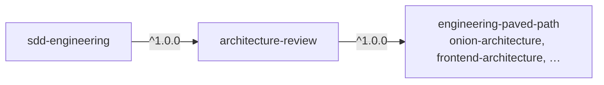

# architecture-review

A read-only `architecture-reviewer` agent that checks whether code keeps the project's architectural boundaries: imports point inward, I/O stays in adapters, the core stays pure, adapters are wired only in the composition root, environment variables are read only at their chokepoints, contracts live in one place, modules don't reach into each other's internals, and frontend code sits where it belongs. Every finding is proven with a re-opened `path:line`, an import chain or command output; a clean review is a normal result. It returns stable `F1…` ids that an implementer can fix by id, and a **PASS/BLOCK** verdict driven by a small, closed catalog of CRITICAL violations, so the gate stays predictable.

## Install

```bash
claude plugin install architecture-review@shark-plugins
```

The dependency `engineering-paved-path` (the architecture and stack skills the reviewer uses) installs automatically. The agent becomes available as `architecture-review:architecture-reviewer`.

## Components

| Component | Type | What it does | When to use |
|---|---|---|---|
| `architecture-reviewer` | agent (`opus`, `maxTurns` 40; `Read`, `Grep`, `Glob`, `Skill`, `Bash` with a read-only allowlist) | Reviews a diff or a module against boundary checks `A1…A12`, returns findings `F1…` with evidence, a *For fix mode* list and PASS/BLOCK | After implementation and before a PR, in a fresh context; to audit a module's layering |

Skills (from `engineering-paved-path`): `onion-architecture` is preloaded into every review. The stack skills `frontend-architecture`, `next-best-practices`, `fastify-best-practices`, `zod` and `typescript-expert` are loaded with the `Skill` tool only when the code in scope uses that stack, so a backend-only review does not pay for frontend rules.

## Usage

**Diff mode** (default): review the changed lines against a base ref, or the uncommitted work when no base is given.

```text
Use architecture-review:architecture-reviewer on the diff against origin/main.
```

```text
Use architecture-review:architecture-reviewer on the working tree.
```

**Module mode**: audit every file under one or more paths. Violations that no current change touched are *informational* and never block.

```text
Use architecture-review:architecture-reviewer in module mode on src/modules/billing and src/adapters/payments.
```

**With a plan** (optional context): code placed where the plan did not justify it gets a closer look.

```text
Use architecture-review:architecture-reviewer on the working tree, plan docs/plans/07-invoices.md.
```

### The checks

The checks are generic. Their concrete paths (which folder is the core, which file is the composition root, which files may read env) come from your project's instructions (`CLAUDE.md`, `AGENTS.md`, architecture docs), or from the `engineering-paved-path:onion-architecture` layer map applied to your folder names, or from the code when it is unambiguous. A check whose paths can't be established is reported under *Checks not run*, never guessed.

| # | Boundary |
|---|---|
| A1 | Dependency direction: every import points inward; transport and application code reach infrastructure only through ports |
| A2 | Pure core: no fs, network, HTTP client, DB driver, framework, subprocess or env in the core |
| A3 | Contract boundary: contracts used by a changed consumer come from the project's contract location; no local redefinition |
| A4 | Contract-copy sync for the fields the change touched (when the project keeps copies) |
| A5 | Composition-root wiring: concrete adapters constructed only in the composition root |
| A6 | I/O only in adapters/repositories |
| A7 | Thin transport: handlers validate via their schema, call a service, reply |
| A8 | Env reads only at the configured chokepoints |
| A9 | Module layout and registration per the project's convention |
| A10 | No cross-module private imports |
| A11 | Frontend placement: no fetching in components, colocated feature code, thin pages, server/client boundary |
| A12 | Naming, test tier in the filename, generated/vendored/protected paths untouched |

If the project has a dependency-cruiser config, the agent runs the locally installed `depcruise` with it and cites its output for A1; otherwise it walks imports itself.

### Severity and verdict

- **CRITICAL** (closed catalog, the only thing that blocks): I/O in the pure core; an application service importing a concrete adapter; a transport handler reaching directly into adapters/infrastructure; contract drift on fields the change touched.
- **HIGH**: any other boundary violation. **MEDIUM**: naming and placement nits.
- **Skeptic pass**: every CRITICAL is challenged (is it a changed line, does the import really cross the layer through barrels and re-exports, is it a listed exception?). A refuted CRITICAL is downgraded to HIGH and listed, never dropped.
- **BLOCK** if and only if an in-change CRITICAL survives the skeptic pass.

### What the report looks like (abridged)

```md
# Architecture Review — origin/main..HEAD

**Mode:** diff · **Plan:** none · **Layer map:** project instructions
**Verdict:** BLOCK — F1 (service imports concrete adapter)
**Read-only:** `git status --porcelain` unchanged: yes

## Checks run
**Pass:** A1–A12 except the rows below — `rg` import walk over 9 files
| # | Check | Files | Result |
|---|---|---|---|
| A5 | composition-root wiring | 2 | ❌ 1 finding |
| A11 | frontend placement | — | n/a: no frontend files changed |

## Findings
| ID | Severity | File:line | Rule (source) | Issue | Evidence | Fix direction |
|---|---|---|---|---|---|---|
| F1 | CRITICAL | `src/modules/orders/service.ts:12` | A1/A5 · catalog: service imports concrete adapter | … | `import { StripeClient } from '../../adapters/stripe'` | depend on the payment port; bind in the composition root |
| F2 | HIGH | `src/modules/orders/routes.ts:30` | A8 | env read outside chokepoints | `process.env.ORDERS_LIMIT` | inject via config |

## For fix mode
- Blocking: F1 (`src/modules/orders/service.ts:12`)
- Non-blocking, worth fixing: F2

## Checks not run
- dependency-cruiser — no config in the repo
```

Other sections: *Informational* (module mode), *Downgraded by skeptic pass*, *Pre-existing*, *Handoff* (out-of-scope concerns, doc drift), *Insight candidates*. Reports stay under ~900 words (~400 with no findings). With a missing or ambiguous target the agent returns a *Clarification needed* block; with an empty diff or unknown base ref, `Status: blocked`.

## Configuration

None required. What the agent reads when present:

- **Project instructions** (`CLAUDE.md`, `AGENTS.md`, per-package equivalents) and the architecture docs they point to: the source of your layer map, env chokepoints, module layout, naming rules and known exceptions. The more explicit they are, the more precise the review. A short "where code lives" table with layer → folder and a list of files allowed to read env is the single most useful thing to add.
- **`.sdd/config.json`** (optional): `excludeFromSearch` (paths to skip), `testTiers` (test filename patterns for A12), `protectedPaths` (paths not to edit by hand, for A12), `insights` (insights files to read), `plansDir` (where plans live).
- **A dependency-cruiser config** (`.dependency-cruiser.{js,cjs,mjs,json}`), used for A1 when present.

## How it fits



The plugin works standalone in any repository. `sdd-engineering` depends on it: in the `review` stage of its `run-plan` skill, the reviewer runs **in parallel** with the plan verifier and (when a trust boundary is touched) `security-review:security-reviewer`, in working-tree mode, with the plan path and the list of changed paths. The main session triages the findings by id: CRITICAL and HIGH go to the implementer's fix mode, a fix that needs a file outside the plan becomes a plan change, MEDIUM and informational items become follow-ups. Only reviewers that reported a fix are re-run, for at most three iterations. The `git status --porcelain` snapshots before and after the wave prove no reviewer wrote to the tree.

## Limitations

- **Read-only by prompt and tools, not by hook.** The agent has no `Edit`/`Write`; its `Bash` allowlist (search tools, read-only git, `depcruise`) is a prompt rule. The report's read-only proof (`git status --porcelain` before and after) shows whether it held. Add `deny` permission rules in your project settings if you need runtime enforcement.
- Plugin agents ignore `permissionMode`, `hooks` and `mcpServers` frontmatter; this agent needs none of them.
- The skills come from `engineering-paved-path`, which ships with `defaultEnabled: false`. If the reviewer's report shows it did not apply those skills, enable the plugin (`/plugin` → `engineering-paved-path` → enable).
- The agent never installs `dependency-cruiser`; it uses it only when already installed and configured.
- It does not review security, style, performance or plan compliance; those concerns appear at most as one *Handoff* line.

## Contents

```text
architecture-review/
├── .claude-plugin/plugin.json
├── agents/architecture-reviewer.md
├── CHANGELOG.md
├── NOTICE.md
└── README.md
```
