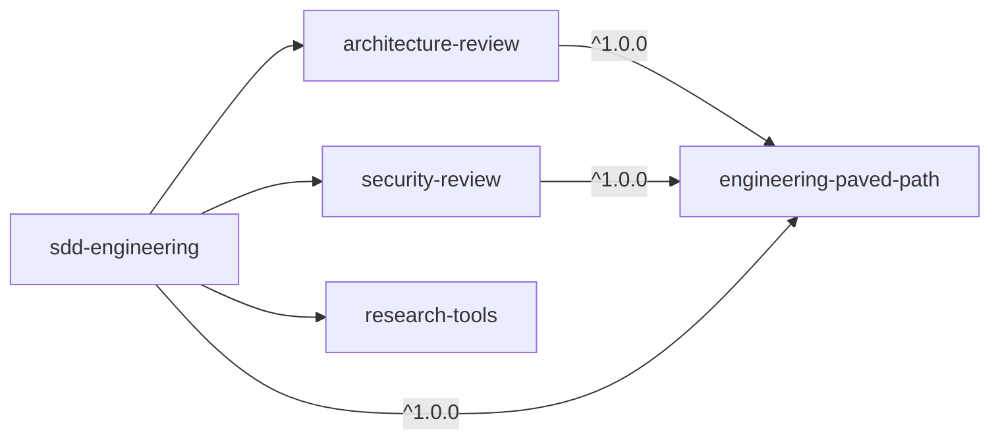

# engineering-paved-path

The shared engineering knowledge for TypeScript web projects, packaged as 13 Claude Code
skills: how a backend is layered (onion / ports-and-adapters), where frontend code lives,
React, Next.js, Fastify, Zod, TypeScript, Drizzle and PostgreSQL practices, OWASP-based web
security, Mermaid diagrams, and a project insights log that carries lessons from one session
to the next. It is the "paved path" that the review and delivery agents in this marketplace
load, so they judge and write code against the same rules. The plugin has no agents of its
own and ships disabled by default (see [Enabling](#enabling)).

## Install

```bash
claude plugin install engineering-paved-path@shark-plugins
```

You rarely install it by hand: `architecture-review`, `security-review` and
`sdd-engineering` declare it as a dependency, and dependencies install automatically with
them. Install it directly when you want the skills in your own sessions.

## Components

All components are skills. Invoke them as `/engineering-paved-path:<skill>` or let Claude
load them when the task matches their description.

| Skill (namespaced id) | Scope | What it covers | When it triggers |
|---|---|---|---|
| `engineering-paved-path:engineering-insights` | meta | Read the project's insights log and distilled rules before a task; append a non-obvious, evidenced finding after it; duplicate check; keep the rules file in step; promote standing rules into `CLAUDE.md` / `AGENTS.md` | Start of any task in a module; a hard-won finding; a wrap-up request |
| `engineering-paved-path:onion-architecture` | backend | Onion / ports-and-adapters layering for TypeScript backends: the inward dependency rule, where routes / services / repositories / adapters / ports live, the DI composition root, env reads at chokepoints, one adapter per external system; check scripts and a dependency-cruiser config | Adding or reviewing a backend module; placing a DB query or SDK call; wiring DI; defining a port |
| `engineering-paved-path:fastify-best-practices` | backend | Fastify routes, plugins and encapsulation, JSON Schema validation, hooks, errors, logging, auth, CORS, testing, deployment (19 rule files) | Building, configuring or debugging a Fastify server |
| `engineering-paved-path:drizzle-orm-patterns` | backend | Drizzle schema, CRUD, relations, joins and aggregations, transactions, migrations | Writing Drizzle schemas, queries or migrations |
| `engineering-paved-path:postgresql-table-design` | backend | PostgreSQL schema design: data types, keys, constraints, indexing, JSONB, partitioning | Designing or reviewing a PostgreSQL schema |
| `engineering-paved-path:frontend-architecture` | frontend | Where React / Next.js code lives: folder structure, colocation, splitting components, business-logic layering, App Router organization | Placing a component, hook, constant or util; restructuring a frontend |
| `engineering-paved-path:react-best-practices` | frontend | React anti-pattern catalog with severities: component design, state, hooks misuse, performance, data fetching | Writing, reviewing or refactoring React components and hooks |
| `engineering-paved-path:next-best-practices` | frontend | Next.js App Router: file conventions, RSC boundaries, data patterns, async APIs, metadata, errors, route handlers, images, fonts, bundling, self-hosting | Writing or reviewing Next.js code |
| `engineering-paved-path:react-testing-library` | frontend | Fewer, longer user-flow tests with React Testing Library, Vitest and MSW; scenario matrix per component type | Writing or reviewing React component and hook tests |
| `engineering-paved-path:zod` | full-stack | 42 Zod rules in 8 categories: schema definition, parsing, type inference, errors, objects, composition, refinements, performance | Defining or reviewing Zod schemas and validation |
| `engineering-paved-path:typescript-expert` | full-stack | Type-level programming, strictness, performance, monorepos, migrations, tooling; references and a diagnostic script | Hard TypeScript type or tooling problems; tsconfig and migration work |
| `engineering-paved-path:security` | full-stack | OWASP Top 10:2025 web-app security: access control, injection, auth and sessions, secrets, uploads, misconfiguration, logging; examples in React / Express / MongoDB / JWT, principles for any stack | Security review of web-app code; auth, input handling, uploads, secrets, API endpoints |
| `engineering-paved-path:mermaid-diagram` | meta | Mermaid flowcharts, sequence, class, ER and state diagrams in Markdown | Visualizing a workflow, architecture, API flow or data model |

## Usage

### Invoke a skill directly

```text
/engineering-paved-path:onion-architecture where should a call to the Stripe API go in src/modules/billing?
/engineering-paved-path:engineering-insights wrap up: record what we learned about the flaky import test
/engineering-paved-path:frontend-architecture split app/dashboard/page.tsx, it is 600 lines
/engineering-paved-path:mermaid-diagram sequence diagram of the login flow in src/auth
```

Or describe the task and let Claude pick the skill: "Review src/modules/billing for
layering violations" loads `onion-architecture`; "Is this useEffect an anti-pattern?" loads
`react-best-practices`.

### What the output looks like

Skills shape the work rather than produce a fixed report. Two of them do have a fixed shape:

`engineering-insights`, at the start of a task:

```text
Insights: src/modules/billing → insights/gotchas.md (6 rules), INSIGHTS.md (23 entries).
Bearing on this task: "Run the migration generator twice when a table drops and adds a column".
```

and the entry it appends at the end (only when a finding clears the quality gate):

```md
### 2026-10-19 — integration tests silently skipped without the .it suffix
**Symptom:** a new DB-backed test passed locally and never ran in CI.
**Cause:** the unit job excludes `*.it.test.*`; the file had no suffix.
**Rule:** any test touching the database carries the integration suffix.
**Evidence:** `vitest.config.ts:12` · `.github/workflows/ci.yml:40`
```

`onion-architecture` checks, with the layout passed as arguments:

```bash
bash "${CLAUDE_SKILL_DIR}/scripts/check-module.sh" src/modules/billing
node "${CLAUDE_SKILL_DIR}/scripts/trace-imports.mjs" src/modules/billing --alias @app/ports=src/ports
```

```text
[services-depend-on-ports]
  src/modules/billing/service.ts:2 → src/modules/_shared/forge.ts:1 → src/adapters/git/client.ts
[no-foreign-consumer-ports]
  src/modules/invoices/service.ts:1 (type) → src/modules/billing/types.ts { BillingCustomerPort }
```

(`${CLAUDE_SKILL_DIR}` is filled in by Claude Code when the skill loads; the skill text
gives Claude the resolved path.)

## Configuration

Most skills need none. Two read project settings when they exist:

| Skill | Reads | Purpose |
|---|---|---|
| `engineering-insights` | `.sdd/config.json` → `insights.log` (default `INSIGHTS.md`), `insights.rules` (default `insights/gotchas.md`), `packages` (default `["."]`), `excludeFromSearch` | Where the log and rules files live, per package. A convention stated in the project's `CLAUDE.md` / `AGENTS.md` takes precedence. Without either, the defaults apply at the project root. |
| `onion-architecture` | The layer mapping, env chokepoints, exceptions and drift documented in `CLAUDE.md` / `AGENTS.md`; a dependency-cruiser config if present | Maps the project's folders onto the reference layout. Without a documented mapping the skill infers one and states it. |

Example `.sdd/config.json` fragment for a monorepo:

```json
{
  "packages": ["apps/api", "apps/web"],
  "insights": { "log": "INSIGHTS.md", "rules": "insights/gotchas.md" }
}
```

## How it fits

This plugin has no dependencies. Agents in other plugins preload some of its skills through
their `skills:` frontmatter and read others on demand:

| Plugin → agent | Preloads | Reads on demand |
|---|---|---|
| `architecture-review` → `architecture-reviewer` | `engineering-insights`, `onion-architecture`, `frontend-architecture`, `next-best-practices`, `fastify-best-practices`, `zod`, `typescript-expert` | — |
| `security-review` → `security-reviewer` | `security`, `engineering-insights` (plus its own `security-review:appsec-review`) | `fastify-best-practices`, `zod` |
| `sdd-engineering` → `implementation-planner`, `implementer` | `engineering-insights`, `onion-architecture` | the skills listed under *Skills to apply* in the plan |
| `sdd-engineering` → `test-writer` | `engineering-insights`, `security` | `react-testing-library`, `fastify-best-practices`, `drizzle-orm-patterns`, `zod`, … per the plan |
| `sdd-engineering` → `doc-writer` | `engineering-insights`, `mermaid-diagram` | — |
| `sdd-engineering` → `spec-creator`, `plan-verifier`, `brainstormer` | `engineering-insights` | — |



### Enabling

The plugin sets `"defaultEnabled": false`. Thirteen skill descriptions in every session cost
context, and most projects use only part of this stack, so it stays off until you turn it
on. Agents that depend on it name its skills explicitly. To use the skills in your own
sessions, enable it:

- interactively: `/plugin` → **Installed** → `engineering-paved-path` → **Enable**;
- for everyone on a project, in the committed `.claude/settings.json`:

  ```json
  {
    "enabledPlugins": { "engineering-paved-path@shark-plugins": true }
  }
  ```

Check its context cost with `claude plugin details engineering-paved-path`.

### Adding a project-specific skill on top

Keep project knowledge in the project, next to these generic skills:

1. Create a project skill (`skills/<name>/SKILL.md` inside the project's `.claude` folder),
   or a skill in your own team plugin, with a `name` and a trigger-first `description`.
2. Narrow it to what is specific to the project: the folder → layer mapping, the env
   chokepoints, the documented exceptions, project trust boundaries. Refer to the generic
   rules by id ("apply `engineering-paved-path:onion-architecture`; in this repo the ports
   live in `packages/contracts`") instead of copying them.
3. For mappings that every session needs, a short section in `CLAUDE.md` / `AGENTS.md` is
   often enough; `onion-architecture/layer-map.md` has a template.
4. A team plugin that preloads these skills in its own agents must declare
   `engineering-paved-path` in `dependencies`.

## Limitations

- **Disabled by default.** The skills don't trigger automatically in your sessions until the
  plugin is enabled (see [Enabling](#enabling)). If an agent from a dependent plugin reports
  that a preloaded skill is missing, enable this plugin.
- **Stack-specific skills.** Fastify, Next.js, Drizzle, Zod and React skills apply only to
  those libraries; the `security` skill's code examples use React / Express / MongoDB / JWT
  and must be translated to other stacks.
- **Scripts need tools.** `onion-architecture/scripts/trace-imports.mjs` needs Node.js and
  `typescript` in the project's `node_modules` (or `--ts-from`); `check-module.sh` needs
  `bash` and `grep -E`; `typescript-expert/scripts/ts_diagnostic.py` needs Python 3 and runs
  `npx tsc`. On Windows run them from Git Bash or WSL.
- **The dependency-cruiser config is a template.** It is not installed for you and must be
  adapted to the project's folders before its results mean anything.
- **No evals.** The upstream eval suites for `onion-architecture` and `zod` are not included
  in this release.
- **Third-party content.** Most stack skills are copied from community skill repositories
  (see [NOTICE.md](NOTICE.md)) and are updated here, not upstream.

## Contents

```text
engineering-paved-path/
├── .claude-plugin/plugin.json      # defaultEnabled: false, no dependencies
├── skills/
│   ├── engineering-insights/       # SKILL.md, entry-quality.md
│   ├── onion-architecture/         # SKILL.md, layer-map.md, enforcement.md, README.md,
│   │                               # scripts/check-module.sh, scripts/trace-imports.mjs
│   ├── fastify-best-practices/     # SKILL.md, rules/*.md
│   ├── drizzle-orm-patterns/       # SKILL.md, references/*.md
│   ├── postgresql-table-design/    # SKILL.md
│   ├── frontend-architecture/      # SKILL.md, README.md, 3 reference files
│   ├── react-best-practices/       # SKILL.md, examples.md
│   ├── next-best-practices/        # SKILL.md, 19 topic files
│   ├── react-testing-library/      # SKILL.md, README.md
│   ├── zod/                        # SKILL.md, AGENTS.md, README.md, references/, assets/
│   ├── typescript-expert/          # SKILL.md, references/, scripts/ts_diagnostic.py
│   ├── security/                   # SKILL.md, examples.md, checklists.md, references.md
│   └── mermaid-diagram/            # SKILL.md, examples.md
├── README.md
├── CHANGELOG.md
└── NOTICE.md
```
