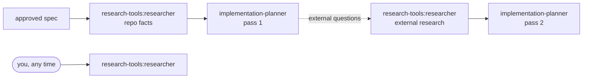

# research-tools

A read-only `researcher` agent for questions that need a **sourced answer rather than an edit**. It works in two modes: *repo research* (where does X live, how does Y work here, when and why did Z change) and *external research* (library behaviour, API and version facts, upstream issues, prior art). Every claim in its report carries a `path:line` or a fetched URL and is labelled `fact` or `inference`, and every report ends with an explicit **Not established** list, so you can see what it could not prove instead of getting a confident guess. Use it before planning a change, when onboarding to a codebase, or whenever "I think it works like this" isn't good enough.

## Install

```bash
claude plugin install research-tools@shark-plugins
```

The plugin has no dependencies and no configuration. The agent becomes available as `research-tools:researcher`.

## Components

| Component | Type | What it does | When to use |
|---|---|---|---|
| `researcher` | agent (`sonnet`, `maxTurns` 40; `Read`, `Grep`, `Glob`, `Bash` with a read-only allowlist, `WebSearch`, `WebFetch`) | Answers a concrete question about the repo, external libraries/APIs, or both, with an evidence table, `fact`/`inference` labels and a mandatory *Not established* section | Before planning; when a question needs citations; to check a library's behaviour against the version you actually use |

## Usage

Ask the main session to delegate, naming the agent:

```text
Use the research-tools:researcher agent to find out where request authentication happens in this repo and which routes skip it.
```

```text
Use research-tools:researcher: does our installed version of zod support `z.string().url()` restricting the scheme, and what changed in v4?
```

```text
Use research-tools:researcher: why was the retry wrapper in src/http/retry.ts added? Check git history.
```

**Ask a concrete question.** If the request names only a topic ("look into the review pipeline"), the scope is undecidable, or the deciding criterion is missing ("is this fast enough?"), the agent does no research and returns a *Clarification needed* block: at most three blocking questions, each with a default you can accept with "yes". A broad but answerable question is researched and scoped, not bounced.

**Modes.**

- *Repo research* reads the project's instructions (`CLAUDE.md`, `AGENTS.md`, per-package equivalents) and insights files first when they exist, then greps wide and reads narrow, follows the call chain, uses git for the *why* and tests as documentation. It skips `node_modules/`, build output, and anything listed in `.sdd/config.json` → `excludeFromSearch`.
- *External research* searches, then **fetches** every source it cites (a search snippet is never evidence), prefers primary sources, pins the library version the repo actually uses, dates every source, and reports disagreements instead of averaging them.
- *Mixed* questions get both reports, repo first, with one combined *Not established*.

**What the report looks like** (repo mode, abridged):

```md
# Repo research — where is request authentication enforced, and which routes skip it?

## Answer
Authentication is a global `onRequest` hook registered in `src/app.ts`; it skips any route whose
config sets `public: true`. Three routes set it: health, login and the OAuth callback.

**Confidence:** high — hook and all three opt-outs opened and quoted.

## Evidence
| # | Claim | Kind | Where | What it says |
|---|-------|------|-------|--------------|
| 1 | Auth runs on every request | fact | `src/app.ts:41-48` | `app.addHook('onRequest', authenticate)` |
| 2 | `public: true` bypasses it | fact | `src/plugins/auth.ts:12` | `if (req.routeOptions.config.public) return` |
| 3 | No other bypass exists | inference | rows 1–2 · `rg -n "public: true"` → 3 hits | only the hook checks the flag |

## Not established
- Whether the reverse proxy adds its own auth — searched: `rg -n "auth" deploy/` — no proxy config in the repo.

## Search log
`rg -n "addHook\('onRequest'" src` · `rg -n "public: true" src`
```

External reports add a *Sources* table (title, URL, published, accessed, primary/secondary), *Conflicts and caveats*, and *Applies to this repo* (your version, your usage site).

**Budget.** About 15 searches + fetches per mode, stopping earlier once every sub-question is backed. When the budget runs out, the open points go to *Not established* with what was tried.

## Configuration

None required. When present, the agent reads:

- the project's instructions (`CLAUDE.md`, `AGENTS.md`, per-package equivalents);
- `.sdd/config.json` → `insights` (the insights log and rules files) and `excludeFromSearch` (extra paths to skip), and `testTiers` when the question is about test coverage. Without the file it falls back to `INSIGHTS.md` / `insights/gotchas.md` where they exist.

## How it fits

`research-tools` is standalone: it depends on nothing and works in any repository. The `sdd-engineering` plugin depends on it and calls the agent from its `run-plan` skill:

- **`research` stage** (after the spec is approved, optional, default yes): the researcher gets the spec path and up to 8 questions seeded from the spec's *Facts needed*; its answers feed the implementation planner.
- **`ext-research` stage**: when the planner's first pass lists external risks or open questions, a separate researcher run answers them before the plan is finalized.



## Limitations

- **Read-only by prompt and tools, not by hook.** The agent has no `Edit`/`Write`. Its `Bash` is restricted by a command allowlist in its prompt (search tools and read-only git). Nothing in the plugin enforces that allowlist at runtime; if you need a hard guarantee, add `deny` permission rules for mutating commands in your project settings or run Claude Code in a sandbox.
- Plugin agents ignore `permissionMode`, `hooks` and `mcpServers` frontmatter; this agent does not need them.
- Web research needs `WebSearch`/`WebFetch` to be allowed in your environment. Client-rendered pages and paywalls often fail to fetch; such sources end up under *Not established*.
- The agent does not run `/deep-research` or other multi-agent research; long research campaigns belong to the caller.

## Contents

```text
research-tools/
├── .claude-plugin/plugin.json
├── agents/researcher.md
├── CHANGELOG.md
├── NOTICE.md
└── README.md
```
