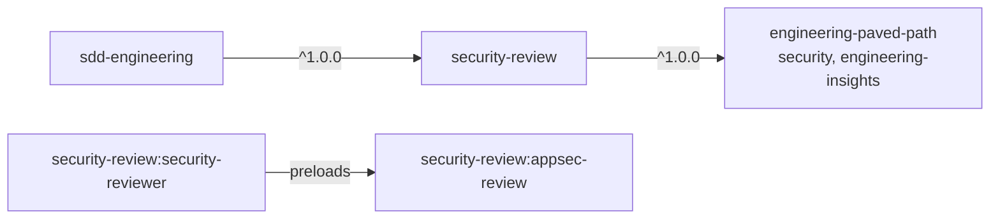

# security-review

A read-only `security-reviewer` agent and the `appsec-review` skill it runs on. The agent traces untrusted data (request input, webhook payloads, uploaded or cloned content, PR and issue text, LLM output) from a **source** to a **sink** (SQL, a subprocess argv, a file path, a credentialed outbound request, an LLM prompt or tool, the DOM, logs) across your project's trust boundaries. The bar is high on purpose: no finding without a quoted attacker-controlled source **and** a quoted reachable sink, confidence ≥ 0.8, and a filter pass against a never-report list. You get stable `SF1…` ids for fixing by id and a **PASS/BLOCK** verdict that blocks only on a closed catalog of CRITICAL issues. Most changes touch no trust boundary at all, and a short clean report is a normal result.

## Install

```bash
claude plugin install security-review@shark-plugins
```

The dependency `engineering-paved-path` (general security and stack skills) installs automatically. The agent becomes available as `security-review:security-reviewer`, the skill as `security-review:appsec-review`.

## Components

| Component | Type | What it does | When to use |
|---|---|---|---|
| `security-reviewer` | agent (`opus`, `maxTurns` 40; `Read`, `Grep`, `Glob`, `Bash` with a read-only allowlist) | Reviews a diff or a module for source → sink security defects, returns `SF1…` findings with quoted evidence, a *For fix mode* list and PASS/BLOCK | After implementation, alongside architecture review, or before a PR, in a fresh context |
| `appsec-review` | skill (preloaded by the agent) | Knowledge: how to discover the project's trust boundaries (code + `.sdd/security.md`), check catalog `X1…X17` with OWASP 2025 / ASVS 5.0 ids, the seven LLM-application controls, never-report list `NR1…NR13` | Loaded by the agent; open it yourself when threat-modelling a feature or writing `.sdd/security.md` |

The agent also preloads `engineering-paved-path:security` (general secure-coding background) and `engineering-paved-path:engineering-insights`. Stack skills such as `engineering-paved-path:fastify-best-practices` and `engineering-paved-path:zod` are read on demand.

## Usage

```text
Use security-review:security-reviewer on the diff against origin/main.
```

```text
Use security-review:security-reviewer on the working tree.
```

```text
Use security-review:security-reviewer in module mode on src/webhooks and src/ai.
```

```text
Use security-review:security-reviewer on the working tree, plan docs/plans/07-invoices.md.
```

**Diff mode** (default) reviews changed lines; untouched code is *pre-existing*. **Module mode** audits every file under the target paths; issues no change touched are *informational* and never block. The plan is optional context.

### How a review runs

1. Snapshot `git status --porcelain` (compared at the end as the read-only proof).
2. Read the project's instructions, insights files and `.sdd/security.md`.
3. Build the trust-boundary map (`.sdd/security.md` → instructions → code) and pick the `X#` rows the changed files can touch. No boundary touched → "None — no trust boundary touched." and a short report.
4. Trace each candidate from a quoted source to a quoted sink, using `references/checks.md` (X1–X15) and `references/llm-pipeline.md` (X16–X17).
5. **Filter pass** on every candidate: never-report ids (`NR1…NR13`, plus the project's `NRP#`), then skeptic questions (is the source really attacker-controlled on a changed line, is the sink reachable, does an upstream control already close it?). Filtered candidates are listed with the reason, never dropped silently.
6. Confidence bands: ≥ 0.8 is reported; 0.7–0.8 goes to *Needs manual check* (at most 5, never blocks); < 0.7 is not reported.

### The check catalog

| X# | Check | X# | Check |
|---|---|---|---|
| X1 | Input validation at the boundary | X10 | XSS / unsafe HTML |
| X2 | Authentication (missing, fail-open, token verification) | X11 | CSRF, CORS and exposure config |
| X3 | Authorization, vertical and horizontal (IDOR, mass assignment) | X12 | Webhook and signature verification |
| X4 | SQL / query injection | X13 | Secrets handling |
| X5 | Command and argv injection | X14 | Error handling and log leakage |
| X6 | Template, code and expression injection | X15 | Dependencies (audit itself left to CI) |
| X7 | Unsafe deserialization, prototype pollution | X16 | LLM input: prompt injection, incl. into tools |
| X8 | SSRF and credentialed outbound requests | X17 | LLM output reaching sinks, excessive agency |
| X9 | Path traversal and file access | | |

Prompt injection is deliberately **in scope**: unlike Anthropic's `claude-code-security-review`, which excludes it, a broken or bypassed injection control in a project that uses an LLM is always reportable.

### Severity and verdict

- **CRITICAL** (closed catalog, the only thing that blocks): **C1** unvalidated external input crossing a trust boundary (incl. injection, path traversal, SSRF, unsafe HTML, prompt injection into tools, missing or fail-open authn/authz); **C2** a secret or credential committed in the diff.
- **HIGH**: any other real source → sink path. **MEDIUM**: defense in depth.
- A CRITICAL refuted by the skeptic pass is downgraded to HIGH and listed. A repo comment saying "intentional / test / ignore" never lowers a finding.
- **BLOCK** if and only if an in-change CRITICAL survives the filter pass.

### What the report looks like (abridged)

```md
# Security Review — origin/main..HEAD
**Mode:** diff · **Plan:** none · **Boundary map:** `.sdd/security.md` + code
**Verdict:** BLOCK — SF1 (C1: IDOR on invoice download)
**Read-only:** `git status --porcelain` unchanged: yes

## Trust boundaries touched
| X# | OWASP · ASVS | Boundary | Changed files | Source → sink traced |
|---|---|---|---|---|
| X3 | A01 · V8 | B1 public API | `src/routes/invoices.ts` | `req.params.id` → `invoices.findById` |

## Findings
| ID | Severity | Conf. | File:line | Check · catalog item | Source → sink (both quoted) | Exploit, one line | Filter pass | Fix direction |
|---|---|---|---|---|---|---|---|---|
| SF1 | CRITICAL | 0.9 | `src/routes/invoices.ts:22` | X3 · C1 | `req.params.id` → `db.invoices.findById(id)` | any user downloads any invoice by id | survived: no NR hit; no owner filter upstream | scope the query to `req.user.orgId` |

## For fix mode
- Blocking: SF1 (`src/routes/invoices.ts:22`)
- Non-blocking, worth fixing: None.

## Filtered out (never silently dropped)
- Unbounded page size on `/invoices` — NR1

## Not reported by design
- None.

## Checks not run
- Dependency audit (X15) — needs network; CI runs it.
```

Other sections: *Checks run*, *Needs manual check*, *Downgraded by skeptic pass*, *Informational* (module mode), *Pre-existing*, *Handoff*, *Insight candidates*. Reports stay under ~900 words (~400 with no findings), at most 8 findings.

## Configuration

### `.sdd/security.md` (optional, recommended)

A Markdown file at the project root where you declare your threat model. The reviewer starts from it, verifies it against the code, and reports stale entries under *Handoff*. Every section is optional; ids (`B#`, `NRP#`) are cited in reports.

```md
# Security model

## Exposure
Internet-facing API behind a reverse proxy; admin UI on the internal network only.

## Trust boundaries
- B1 — Public HTTP API (`src/routes/**`): anonymous and authenticated users. Controls: `authPlugin` (`src/plugins/auth.ts`), Zod schemas on every route.
- B2 — Payment-provider webhook (`src/webhooks/stripe.ts`): verified by HMAC signature.
- B3 — LLM summarizer (`src/ai/**`): prompts include user-supplied documents; output rendered in the web UI.

## Sources
- Request body, query, params and headers on B1
- Uploaded files (`src/uploads/**`)
- Webhook payloads on B2
- Model output from B3

## Sinks
- Postgres via the query builder; raw SQL only in `src/db/reports.ts`
- `child_process.execFile` in `src/adapters/imagemagick.ts`
- Outbound HTTP with stored API keys: `src/adapters/http.ts`
- `dangerouslySetInnerHTML` in `web/components/Markdown.tsx` (sanitized by DOMPurify)

## Controls and chokepoints
- Secrets: only `src/config/secrets.ts` reads secret env vars
- Outbound hosts: allowlist in `src/adapters/http.ts:ALLOWED_HOSTS`

## Not applicable by design
- OWASP A07, ASVS V6–V7: no end-user authentication — single-user local tool.

## Never report
- NRP1 — Secrets stored unencrypted in the user's own config directory (`~/.myapp/`): accepted for a single-user local tool.
- NRP2 — Missing CSRF tokens on `/internal/**`: reachable only from the internal network behind mTLS.
```

| Section | What the reviewer does with it |
|---|---|
| Exposure | Severity context; the baseline for "loosening" CORS, bind host or rate limits (X11) |
| Trust boundaries (`B#`) | Starting list for *Trust boundaries touched* |
| Sources / Sinks | Where each source → sink trace starts and ends |
| Controls and chokepoints | Verified still in place; bypassing one is a finding |
| Not applicable by design | Listed under *Not reported by design* |
| Never report (`NRP#`) | Added to the filter pass after `NR1…NR13`. Cannot exclude a whole CRITICAL category or prompt injection |

Without the file the reviewer derives boundaries from your instructions and code. It never declares authentication "not applicable" for an internet-facing service on its own.

### Other inputs

- Project instructions (`CLAUDE.md`, `AGENTS.md`, per-package equivalents): exposure, auth model, secrets chokepoints.
- `.sdd/config.json` (optional): `excludeFromSearch`, `insights`, `plansDir`.

## How it fits



The plugin works standalone in any repository. `sdd-engineering` depends on it: in the `review` stage of its `run-plan` skill, the security reviewer runs **only when the change touches a trust boundary**, in parallel with the plan verifier and `architecture-review:architecture-reviewer`, in working-tree mode, with the plan path and the list of changed paths. The main session triages by id: CRITICAL and HIGH `SF` findings go to the implementer's fix mode, MEDIUM and informational ones become follow-ups, and *Needs manual check* items are shown to you at sign-off. The loop re-runs only reviewers that reported a fix, for at most three iterations.

## Limitations

- **Read-only by prompt and tools, not by hook.** The agent has no `Edit`/`Write`; its `Bash` allowlist (search tools, read-only git, offline `npm ls`/`pnpm ls`) is a prompt rule, and the report's `git status --porcelain` proof shows whether it held. Add `deny` permission rules in your project settings for runtime enforcement.
- Plugin agents ignore `permissionMode`, `hooks` and `mcpServers` frontmatter; this agent needs none of them.
- **No network.** The agent does not run `npm audit` or look up CVEs; the dependency audit is always listed under *Checks not run* for CI to cover.
- It reviews your own code, not third-party dependencies' internals, and it is not a penetration test or a DAST scan.
- `engineering-paved-path` ships with `defaultEnabled: false`. If the report shows the general security skill was not applied, enable it (`/plugin` → `engineering-paved-path` → enable).
- ASVS references are chapter-level; exact requirement ids need a lookup in the ASVS 5.0 text.

## Contents

```text
security-review/
├── .claude-plugin/plugin.json
├── agents/security-reviewer.md
├── skills/appsec-review/
│   ├── SKILL.md
│   └── references/
│       ├── checks.md          # X1–X15: how to check, what to quote, false positives
│       ├── llm-pipeline.md    # X16–X17: the seven LLM-application controls
│       ├── never-report.md    # NR1–NR13 + project NRP#, MIT notice (Anthropic)
│       └── sources.md         # OWASP/ASVS/LLM sources and licence rule
├── CHANGELOG.md
├── NOTICE.md
└── README.md
```
